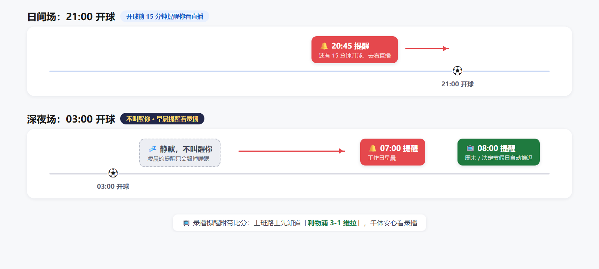

# 看球不熬夜闹钟 · Football Replay Alarm

> 给熬夜不动了的球迷的"录播闹钟"——深夜比赛**不叫醒你**，第二天早晨准点叫你去看录播。

一个不打扰、无广告、不收集个人信息的 Android 提醒 App，专门做一件事：把你关注的欧洲俱乐部的比赛日程，**按你的作息**变成准点的通知。

[](https://github.com/goalgoalboy2025/football-replay-alarm/actions/workflows/ci.yml)
[](https://github.com/goalgoalboy2025/football-replay-alarm/releases)
[](LICENSE)
[](https://kotlinlang.org)
[](https://developer.android.com/jetpack/compose)
[](https://developer.android.com/about/versions/nougat)
[](docs/release-checklist.md)

## 它和直播吧 / 懂球帝有什么不同

| | 直播吧 / 懂球帝 | 本 App |
| --- | --- | --- |
| 03:00 的欧冠 | 02:45 推送叫醒你 | **不叫。早晨 07:00 提醒你去看录播（附带比分）** |
| 21:00 的英超 | 20:45 提醒 | 20:45 提醒（一样） |
| 节假日早晨 | 无区别 | 自动 07:00 → 08:00（中国法定节假日） |
| 送达机制 | 推送通道（国内 ROM 不可靠，无 GMS 时 FCM 失效） | 系统 `AlarmManager.setAlarmClock()`，不依赖推送 / GMS / 长连接 |
| 隐私 | 广告 SDK、统计、需登录 | 不收集不上传，无账号无广告 |

## 三段制提醒规则



| 开球时段（北京时间） | 提醒方式 | 触发时间 |
| --- | --- | --- |
| 09:00 — 22:00 | 直播提醒 | 开球前 15 分钟 |
| 22:00 — 24:00 | 录播提醒 | 次日早晨 |
| 00:00 — 09:00 | 录播提醒 | 当日早晨 |

早晨时间可在首启动向导和设置里自定义，工作日和节假日分别设置（5:00 — 12:00 任选），节假日用 [timor.tech](https://timor.tech/) 法定节假日数据自动判定。

## 技术实现：为什么必须用 `setAlarmClock()`

**症状**：2 分钟的测试闹钟每次都准时响，但隔夜的凌晨录播提醒从来不响——这个 App 在修好之前，两种测试结果截然相反。

**根因**：`setExactAndAllowWhileIdle()` 名义上能穿透原生 Doze，但荣耀 MagicOS / 小米 HyperOS 等国产 ROM 会把熄屏一整夜的 App 打入"冻结 / 深度睡眠"，精确闹钟一样被延迟或丢弃。**2 分钟测试的成功掩盖了真实场景的失败**——刚从前台点完按钮、延迟短，系统还来不及冻结你。

**解法**：`AlarmManager.setAlarmClock()`——Android 里唯一被系统当作"用户闹钟"对待的 API（系统时钟 App 同款），能穿透 Doze + 应用待机分桶 + 厂商冻结。代价是状态栏常驻闹钟图标，但对"看球闹钟"而言这恰是用户预期。核心代码在 [`MatchReminderScheduler.kt`](app/src/main/java/io/github/dandan/kanqiutixing/notification/MatchReminderScheduler.kt)：

```kotlin
// 三级降级：setAlarmClock → setExact → setAndAllowWhileIdle
// try/catch 不能省：少数 ROM 对 setAlarmClock 有限制会抛异常，
// 不接住 = 闹钟压根没挂上，且没有任何日志
try {
    am.setAlarmClock(AlarmManager.AlarmClockInfo(triggerAt, pi), pi)
} catch (e: Exception) {
    try { am.setExactAndAllowWhileIdle(type, triggerAt, pi) }
    catch (e: Exception) { am.setAndAllowWhileIdle(type, triggerAt, pi) }
}
```

**第二层坑：闹钟响了 ≠ 用户感知到。** 国产 ROM 会把没声音、没震动、锁屏不可见的通知吞掉或折叠成静默通知。所以本 App 的通知渠道必配：`IMPORTANCE_HIGH` + 显式铃声（`USAGE_ALARM`——不能指望渠道默认值，荣耀上经常是空的）+ 震动 + `VISIBILITY_PUBLIC` + `CATEGORY_ALARM` + `setBypassDnd(true)`。渠道重要度建成后系统不允许 App 再改，但声音/震动可以改 → **每次启动都补一遍**（[`NotificationHelper.kt`](app/src/main/java/io/github/dandan/kanqiutixing/notification/NotificationHelper.kt)）。

**可观测性**：App 内置「提醒健康检查」页（设置入口），不连电脑就能看出通知权限、渠道重要度、精确闹钟、电池白名单、已挂闹钟哪一环断了。

**真机验证**：荣耀 400 Pro（MagicOS 10.0.0.175 / Android 16）凌晨场 → 次日早晨准时响铃 ✅。

完整版（含 5 厂商冻结机制对照、排查时间线、投稿级细节）见 [`docs/oem-alarm-delivery.md`](docs/oem-alarm-delivery.md)；各机型后台保活配置清单见 [`docs/oem-battery-whitelist.md`](docs/oem-battery-whitelist.md)。

> 经验来源：「吧嗒清单」的 ROM 适配实践——诚实注明，反而增加可信度。

## 安装

### 给朋友（不写代码的人）

到本仓库 [Releases 页](https://github.com/goalgoalboy2025/football-replay-alarm/releases) 下载最新的 `apk`，传到 Android 手机点开安装。手机会提示"未知来源应用"——允许一次即可。

**首次启动需填入自己的 football-data.org 免费 token**（30 秒注册，见下文「开发者构建」第 2 步；或在 App 设置 → 数据源里粘贴）。Release 包内不含任何密钥。

**荣耀 / 华为 MagicOS 用户**：装好打开 App，跟着内置的「MagicOS 后台保活引导」5 步走一遍——这一步必须做，否则深夜提醒会被系统冻结。其它品牌参考 [`docs/oem-battery-whitelist.md`](docs/oem-battery-whitelist.md)（荣耀 / 小米 / OPPO / vivo / 华为）。

### 给开发者（从源码构建）

需要 JDK 17、Android Studio Hedgehog (2023.1) 或更新版本。

```bash
git clone https://github.com/goalgoalboy2025/football-replay-alarm.git
cd football-replay-alarm
```

1. **准备数据源 token**（二选一）：
   - 构建注入：到 [football-data.org/client/register](https://www.football-data.org/client/register) 免费注册，把邮件里的 token 填进 `local.properties`：

     ```bash
     cp local.properties.template local.properties
     # 编辑 local.properties：FOOTBALL_DATA_TOKEN=你的token
     ```

   - App 内输入：什么都不配也能构建，首次启动在「设置 → 数据源」里粘贴 token，点「测试并保存」。
2. 编译运行：

```bash
./gradlew installDebug   # 编译并装到连接的手机上
```

> **发布 release 前必须清空 `local.properties` 里的 token 再构建**——Gradle 会在 release 构建检测到 token 非空时打告警。本仓库的 Release 附件均为无密钥构建。

### 出 release 包

需要先生成 keystore + 创建 signing.properties：

```bash
keytool -genkey -v -keystore kanqiutixing-release.jks \
        -keyalg RSA -keysize 2048 -validity 25000 \
        -alias kanqiutixing
cp signing.properties.template signing.properties
# 编辑 signing.properties，把刚才设置的密码填上
```

keystore 和 signing.properties 都在 `.gitignore` 里，不会被意外提交。然后：

```bash
./gradlew assembleRelease
# 产物在 app/build/outputs/apk/release/
```

详细流程见 [`docs/release-apk-guide.md`](docs/release-apk-guide.md) 与 [`docs/release-checklist.md`](docs/release-checklist.md)。

## 默认关注 18 支球队

- 英超：阿森纳、曼城、曼联、切尔西、利物浦、热刺
- 西甲：巴萨、皇马、马竞
- 德甲：拜仁慕尼黑、多特蒙德、勒沃库森
- 意甲：AC 米兰、国际米兰、尤文图斯、那不勒斯
- 法甲：巴黎圣日耳曼、马赛

首启动向导里勾选你关心的（至少 1 支），之后可在设置页里随时增减。全部 18 个球队 id 已逐一通过 football-data.org API 核实；欧冠（CL）在免费档可用。

<details>
<summary><strong>已知限制（点开查看）</strong></summary>

数据源是 [football-data.org](https://www.football-data.org/) 免费档，覆盖五大联赛 + 欧冠。**以下比赛抓不到、不会提醒**：

- 域内杯赛：FA Cup、英联杯、意大利杯、西班牙国王杯、德国杯、法国杯
- 欧联杯、欧协联
- 南美洲赛事、国家队友谊赛

如果你关注的球队当周打的是上面这些杯赛——例如 FA Cup 决赛——本 App 不会提醒。这是数据源约束，未来若切换到付费档或别的数据源会补全。

</details>

## 增减球队

### 方式 A：改 assets/teams.json + 重新打包

往 `app/src/main/assets/teams.json` 的 `teams` 数组里加元素：

```json
{ "id": 92, "type": "CLUB", "nameZh": "皇家社会", "nameEn": "Real Sociedad de Fútbol",
  "country": "Spain", "league": "西甲" }
```

球队 id 用 football-data API 查（需要 token）：

```bash
curl 'https://api.football-data.org/v4/competitions/PD/teams' \
  -H 'X-Auth-Token: <你的token>' | jq '.teams[] | {id,name}'
```

`PD` 是西甲联赛 code，其它：`PL` 英超 / `BL1` 德甲 / `SA` 意甲 / `FL1` 法甲 / `CL` 欧冠。

补完 `teams.json` 重新打包即可——`TeamConfigLoader` 启动时会 diff 数据库自动 upsert。

### 方式 B：远程 JSON 热更新

把同样格式的 JSON 上传到任意公开 URL（GitHub Gist 最简单），在 `local.properties` 设置：

```
TEAMS_REMOTE_URL=https://gist.githubusercontent.com/yourname/xxxxx/raw/teams.json
```

App 启动时会先尝试远程，失败回退到 assets。之后改 Gist 即可改球队，不用重发 APK。

## 项目结构

```
football-replay-alarm/
├── app/src/main/
│   ├── java/io/github/dandan/kanqiutixing/
│   │   ├── KanqiuApp.kt              Application + Hilt 入口
│   │   ├── MainActivity.kt           NavHost + 路由决策
│   │   ├── data/                     仓库 + DAO + DTO（TokenProvider 双轨制）
│   │   ├── di/AppModule.kt           Hilt 模块
│   │   ├── holiday/                  节假日判定（timor.tech）
│   │   ├── notification/             AlarmManager 三级降级 + 通知渠道修补
│   │   ├── ui/                       Compose 屏幕
│   │   │   ├── setup/                4 步首启动向导
│   │   │   ├── schedule/             赛程列表
│   │   │   ├── settings/             设置页（数据源 token + 提醒健康检查）
│   │   │   └── onboarding/           MagicOS 后台保活引导
│   │   └── work/                     WorkManager 周更新 / 重排闹钟
│   ├── assets/
│   │   ├── teams.json                默认 18 支球队（id 已核实）
│   │   └── team_names_zh.json        英→中翻译表
│   └── res/                          字符串、主题、图标
├── docs/                             设计方案 / 数据源调研 / ROM 保活清单 / 发布指南
├── screenshots/                      时间轴信息图
├── preview/ui_mockup.html            浏览器可看的 UI mockup
├── PRIVACY.md                        隐私政策
└── LICENSE                           MIT
```

## 调试

提醒链路上 3 个关键 tag：

```bash
adb logcat -v time \
  -s KanqiuAlarm:* KanqiuScheduler:* KanqiuNotify:* \
     KanqiuWorker:* KanqiuHoliday:* KanqiuReschedule:*
```

正常排闹钟会看到：
```
KanqiuScheduler: set SAME_DAY_REPLAY @ 05-17 08:00 (exact=true, reqCode=12345) [利物浦 vs 阿斯顿维拉 @ 05-17 03:00]
```

闹钟触发时会看到：
```
KanqiuAlarm: onReceive 触发
KanqiuNotify: notifyMatchReminder posted id=12345 type=SAME_DAY_REPLAY
KanqiuAlarm:   ✓ 已发出 SAME_DAY_REPLAY 通知
```

如果通知没弹但 logcat 显示 `KanqiuAlarm:   ⚠️ POST_NOTIFICATIONS 未授权`——去系统设置开通知权限。

## FAQ

**为什么不用国内数据源（懂球帝 / 雷速）？** 免费且条款允许个人 App 使用的结构化赛程 API 里，football-data.org 覆盖最稳；国内源没有公开 API，抓页面随时会坏。

**为什么抓不到足总杯 / 欧联杯？** 免费档的联赛白名单限制，见上方「已知限制」。

**装了还是不提醒？** 九成是国产 ROM 后台冻结——先做 App 内「提醒健康检查」，再对照 [`docs/oem-battery-whitelist.md`](docs/oem-battery-whitelist.md) 配置你的机型。

**早晨时间能改吗？节假日怎么判定？** 5:00–12:00 任选，工作日 / 节假日分开设置；节假日由 timor.tech 的国务院放假安排数据自动判定。

**会上传我的数据吗？** 不会。无账号、无统计、无广告，详见 [`PRIVACY.md`](PRIVACY.md)。

**状态栏的闹钟图标能去掉吗？** 不能。`setAlarmClock()` 是提醒能穿透 ROM 冻结的核心机制，去掉图标等于去掉保活。

**为什么要自己填 token？** Release 包内置密钥等于把开发者的 API 配额公开送人（也已经证明会被烧进 APK）。填一次 30 秒，永久保存在你手机本地。

**支持哪些球队？能加吗？** 默认 18 支五大联赛豪门，可按上方「增减球队」自行添加免费档内的任何球队。欢迎提 PR 补充。

## 隐私

不收集、不存储、不上传任何个人信息——详见 [`PRIVACY.md`](PRIVACY.md)。

## License

[MIT](LICENSE)

## 致谢

- [football-data.org](https://www.football-data.org/) 提供比赛数据
- [timor.tech](https://timor.tech/) 提供中国节假日数据
- 提醒链路灵感来自每个熬夜看了球早晨却又要上班的球迷
- 国产 ROM 通知适配经验参考「吧嗒清单」的实践
